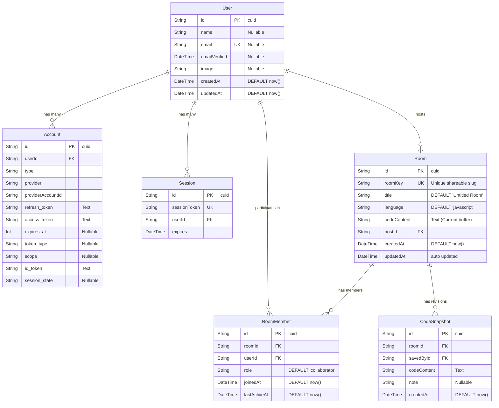

# Database Design Document (DDD)

## Project: Real-Time Collaborative Code Editor with In-Room Voice & AI Assistant

**Document Version:** 1.0  
**Database Engine:** PostgreSQL (Compatible with Neon, Supabase, Railway, Local Docker)  
**ORM:** Prisma ORM  

---

## 1. Database Architecture Overview

The database uses a clean relational structure designed to support:
1. **NextAuth.js Session & Account Management**: Compliant with OAuth 2.0 specs for GitHub and Google authentication.
2. **Room Metadata & Access Management**: Fast lookup by unique, human-friendly `roomKey`.
3. **Room Membership & Roles**: Tracks who is a host vs. who is a collaborator.
4. **Code Persistence & Snapshots**: Persists current editor buffer and allows periodic auto-saving.



---

## 2. Table Specifications & Column Dictionaries

### 2.1 Table: `users`
Stores user profile information synced from GitHub and Google OAuth.

| Column Name | Data Type | Constraints | Default | Description |
| :--- | :--- | :--- | :--- | :--- |
| `id` | `VARCHAR(30)` | `PRIMARY KEY` | `cuid()` | Unique user identifier |
| `name` | `VARCHAR(255)` | `NULLABLE` | `NULL` | Full name or GitHub handle |
| `email` | `VARCHAR(255)` | `UNIQUE`, `NULLABLE` | `NULL` | Primary email address |
| `emailVerified` | `TIMESTAMPTZ` | `NULLABLE` | `NULL` | Verification timestamp |
| `image` | `TEXT` | `NULLABLE` | `NULL` | URL to user's profile avatar |
| `createdAt` | `TIMESTAMPTZ` | `NOT NULL` | `now()` | Account creation timestamp |
| `updatedAt` | `TIMESTAMPTZ` | `NOT NULL` | `now()` | Last profile update timestamp |

---

### 2.2 Table: `accounts` (NextAuth OAuth Provider Accounts)
Stores OAuth access tokens, refresh tokens, and provider IDs.

| Column Name | Data Type | Constraints | Default | Description |
| :--- | :--- | :--- | :--- | :--- |
| `id` | `VARCHAR(30)` | `PRIMARY KEY` | `cuid()` | Record ID |
| `userId` | `VARCHAR(30)` | `FOREIGN KEY` $\to$ `users(id)` `ON DELETE CASCADE` | - | Associated user ID |
| `type` | `VARCHAR(50)` | `NOT NULL` | - | Account type (e.g., `oauth`) |
| `provider` | `VARCHAR(50)` | `NOT NULL` | - | Provider name (`github`, `google`) |
| `providerAccountId`| `VARCHAR(255)`| `NOT NULL` | - | Unique ID from GitHub/Google |
| `refresh_token` | `TEXT` | `NULLABLE` | `NULL` | OAuth refresh token |
| `access_token` | `TEXT` | `NULLABLE` | `NULL` | OAuth access token |
| `expires_at` | `INTEGER` | `NULLABLE` | `NULL` | Token expiration timestamp |
| `token_type` | `VARCHAR(50)` | `NULLABLE` | `NULL` | Token type (e.g. `Bearer`) |
| `scope` | `TEXT` | `NULLABLE` | `NULL` | Granted OAuth scopes |
| `id_token` | `TEXT` | `NULLABLE` | `NULL` | OpenID Connect token |
| `session_state` | `TEXT` | `NULLABLE` | `NULL` | OAuth session state |

*Indexes*: `UNIQUE (provider, providerAccountId)`.

---

### 2.3 Table: `sessions` (NextAuth Session Store)
Tracks active user login sessions.

| Column Name | Data Type | Constraints | Default | Description |
| :--- | :--- | :--- | :--- | :--- |
| `id` | `VARCHAR(30)` | `PRIMARY KEY` | `cuid()` | Record ID |
| `sessionToken` | `VARCHAR(255)` | `UNIQUE`, `NOT NULL` | - | Secure session cookie token |
| `userId` | `VARCHAR(30)` | `FOREIGN KEY` $\to$ `users(id)` `ON DELETE CASCADE` | - | Associated user ID |
| `expires` | `TIMESTAMPTZ` | `NOT NULL` | - | Session expiry date |

---

### 2.4 Table: `rooms`
Represents an individual collaborative coding room.

| Column Name | Data Type | Constraints | Default | Description |
| :--- | :--- | :--- | :--- | :--- |
| `id` | `VARCHAR(30)` | `PRIMARY KEY` | `cuid()` | Internal database ID |
| `roomKey` | `VARCHAR(32)` | `UNIQUE`, `NOT NULL` | - | Human-friendly key (e.g., `code-x9k2p1`) |
| `title` | `VARCHAR(100)` | `NOT NULL` | `'Untitled Room'` | Display title for the workspace |
| `language` | `VARCHAR(30)` | `NOT NULL` | `'javascript'` | Active syntax & execution language |
| `codeContent` | `TEXT` | `NOT NULL` | Starter JS Code | Current persistent text buffer |
| `hostId` | `VARCHAR(30)` | `FOREIGN KEY` $\to$ `users(id)` `ON DELETE CASCADE` | - | Creator of the room |
| `createdAt` | `TIMESTAMPTZ` | `NOT NULL` | `now()` | Room creation timestamp |
| `updatedAt` | `TIMESTAMPTZ` | `NOT NULL` | `now()` | Timestamp of last save |

*Indexes*: 
- `UNIQUE INDEX ON (roomKey)` $\to$ Critical for $O(1)$ room URL routing (`/room/[roomKey]`).
- `INDEX ON (hostId)` $\to$ Fast loading of "Rooms Created By Me" in Dashboard.

---

### 2.5 Table: `room_members`
Maintains records of all users who have joined a room.

| Column Name | Data Type | Constraints | Default | Description |
| :--- | :--- | :--- | :--- | :--- |
| `id` | `VARCHAR(30)` | `PRIMARY KEY` | `cuid()` | Record ID |
| `roomId` | `VARCHAR(30)` | `FOREIGN KEY` $\to$ `rooms(id)` `ON DELETE CASCADE` | - | Room ID |
| `userId` | `VARCHAR(30)` | `FOREIGN KEY` $\to$ `users(id)` `ON DELETE CASCADE` | - | Participant user ID |
| `role` | `VARCHAR(20)` | `NOT NULL` | `'collaborator'` | `'host'` or `'collaborator'` |
| `joinedAt` | `TIMESTAMPTZ` | `NOT NULL` | `now()` | First time user entered room |
| `lastActiveAt` | `TIMESTAMPTZ` | `NOT NULL` | `now()` | Last time user visited room |

*Indexes*: 
- `UNIQUE INDEX ON (roomId, userId)` $\to$ Prevents duplicate membership records.
- `INDEX ON (userId)` $\to$ Fast loading of "Rooms I Joined" in Dashboard.

---

### 2.6 Table: `code_snapshots` (Optional / History Revisions)
Allows users to create named checkpoints or view version history.

| Column Name | Data Type | Constraints | Default | Description |
| :--- | :--- | :--- | :--- | :--- |
| `id` | `VARCHAR(30)` | `PRIMARY KEY` | `cuid()` | Record ID |
| `roomId` | `VARCHAR(30)` | `FOREIGN KEY` $\to$ `rooms(id)` `ON DELETE CASCADE` | - | Associated room ID |
| `savedById` | `VARCHAR(30)` | `FOREIGN KEY` $\to$ `users(id)` `ON DELETE SET NULL` | `NULL` | User who saved snapshot |
| `codeContent` | `TEXT` | `NOT NULL` | - | Snapshot code buffer |
| `note` | `VARCHAR(255)`| `NULLABLE` | `NULL` | Optional label (e.g. "Working Two-Sum solution") |
| `createdAt` | `TIMESTAMPTZ` | `NOT NULL` | `now()` | Timestamp of save |

---

## 3. Production Prisma Schema (`schema.prisma`)

```prisma
datasource db {
  provider = "postgresql"
  url      = env("DATABASE_URL")
}

generator client {
  provider = "prisma-client-js"
}

// -------------------------------------------------------------
// NEXTAUTH MODELS
// -------------------------------------------------------------

model Account {
  id                String  @id @default(cuid())
  userId            String
  type              String
  provider          String
  providerAccountId String
  refresh_token     String? @db.Text
  access_token      String? @db.Text
  expires_at        Int?
  token_type        String?
  scope             String?
  id_token          String? @db.Text
  session_state     String?
  user              User    @relation(fields: [userId], references: [id], onDelete: Cascade)

  @@unique([provider, providerAccountId])
  @@index([userId])
}

model Session {
  id           String   @id @default(cuid())
  sessionToken String   @unique
  userId       String
  expires      DateTime
  user         User     @relation(fields: [userId], references: [id], onDelete: Cascade)

  @@index([userId])
}

model User {
  id            String         @id @default(cuid())
  name          String?
  email         String?        @unique
  emailVerified DateTime?
  image         String?
  accounts      Account[]
  sessions      Session[]
  hostedRooms   Room[]         @relation("RoomHost")
  roomMembers   RoomMember[]
  snapshots     CodeSnapshot[]
  createdAt     DateTime       @default(now())
  updatedAt     DateTime       @updatedAt
}

// -------------------------------------------------------------
// APPLICATION MODELS
// -------------------------------------------------------------

model Room {
  id          String         @id @default(cuid())
  roomKey     String         @unique
  title       String         @default("Untitled Room")
  language    String         @default("javascript")
  codeContent String         @db.Text @default("// Start coding collaboratively here...\nconsole.log('Hello, Collaborative World!');")
  hostId      String
  host        User           @relation("RoomHost", fields: [hostId], references: [id], onDelete: Cascade)
  members     RoomMember[]
  snapshots   CodeSnapshot[]
  createdAt   DateTime       @default(now())
  updatedAt   DateTime       @updatedAt

  @@index([roomKey])
  @@index([hostId])
}

model RoomMember {
  id           String   @id @default(cuid())
  roomId       String
  userId       String
  role         String   @default("collaborator") // "host", "collaborator"
  joinedAt     DateTime @default(now())
  lastActiveAt DateTime @default(now())
  room         Room     @relation(fields: [roomId], references: [id], onDelete: Cascade)
  user         User     @relation(fields: [userId], references: [id], onDelete: Cascade)

  @@unique([roomId, userId])
  @@index([userId])
  @@index([roomId])
}

model CodeSnapshot {
  id          String   @id @default(cuid())
  roomId      String
  savedById   String?
  codeContent String   @db.Text
  note        String?
  createdAt   DateTime @default(now())
  room        Room     @relation(fields: [roomId], references: [id], onDelete: Cascade)
  savedBy     User?    @relation(fields: [savedById], references: [id], onDelete: SetNull)

  @@index([roomId])
}
```

---

## 4. Query Patterns & Performance Optimizations

### 4.1 Dashboard Query: Fetching User's Rooms
```typescript
// Fetches rooms created by the user + rooms user joined
const [createdRooms, joinedRooms] = await Promise.all([
  prisma.room.findMany({
    where: { hostId: session.user.id },
    orderBy: { updatedAt: 'desc' },
    include: {
      members: { include: { user: { select: { id: true, name: true, image: true } } } },
    },
  }),
  prisma.roomMember.findMany({
    where: { userId: session.user.id, role: 'collaborator' },
    orderBy: { lastActiveAt: 'desc' },
    include: {
      room: {
        include: {
          host: { select: { id: true, name: true, image: true } },
        },
      },
    },
  }),
]);
```

### 4.2 Room Join Query: Verify & Upsert Member
```typescript
// Lookup room by human-friendly roomKey and register participant
const room = await prisma.room.findUnique({
  where: { roomKey },
  include: { host: { select: { id: true, name: true, image: true } } },
});

if (room) {
  await prisma.roomMember.upsert({
    where: { roomId_userId: { roomId: room.id, userId: session.user.id } },
    update: { lastActiveAt: new Date() },
    create: {
      roomId: room.id,
      userId: session.user.id,
      role: room.hostId === session.user.id ? 'host' : 'collaborator',
    },
  });
}
```

---

## 5. Migration Strategy

1. **Local Setup**:
   - `npx prisma migrate dev --name init_collaborative_editor`
2. **Production Deployment**:
   - Automatically executes `npx prisma migrate deploy` on deployment pipelines (Vercel / GitHub Actions).
