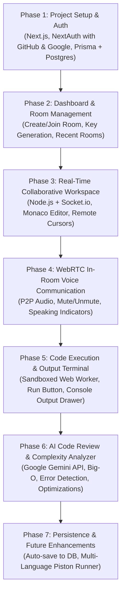

# Product Requirements Document (PRD)

## Project: Real-Time Collaborative Code Editor with In-Room Voice Communication

**Document Version:** 1.0  
**Status:** Approved / Ready for Implementation  
**Target Platform:** Web (Desktop-first)  

---

## 1. Executive Summary & Product Vision

### 1.1 Vision
To build a seamless, browser-based collaborative coding environment where developers, students, and interviewers can write code together in real-time, communicate seamlessly via built-in voice calls, execute JavaScript code instantly in an isolated sandbox, and receive AI-powered code complexity insights.

### 1.2 Core Value Proposition
- **Zero Configuration**: No complex dev environment setup. Start coding together in seconds.
- **Unified Workspace**: Eliminates the need to switch between an IDE and an external voice call app (Zoom, Discord, Meet).
- **Frictionless Sharing**: Join via a direct URL link or a short, shareable room key.

---

## 2. Target Audience & User Stories

### 2.1 Target Personas
1. **Peer Programmers / Teammates**: Need a synchronized coding environment to brainstorm and build algorithms together.
2. **Technical Interviewers & Candidates**: Need a clean, real-time shared workspace with voice interaction and instant test execution.
3. **Students & Mentors**: Need an interactive space for pair-learning and code reviews.

### 2.2 Key User Stories
- **As a developer**, I want to sign in easily with my existing GitHub or Google account so that my profile and rooms persist.
- **As a host**, I want to create a room, receive a unique room key and invite link, and send it to my peer so they can join immediately.
- **As a collaborator**, I want to join my peer's room by clicking a link or pasting a key and see what they type in real time.
- **As a collaborator**, I want to speak to my peer directly within the app without having to open Discord or Google Meet.
- **As a developer**, I want to execute JavaScript code in the browser and see the console output without risking browser freezes from infinite loops.
- **As a developer**, I want AI-driven code reviews to analyze time/space complexity, find runtime bugs, and receive optimization suggestions directly in the editor.
- **As a returning user**, I want to view a dashboard of all rooms I created or joined in the past so I can revisit previous work.

---

## 3. System Architecture & Tech Stack

| Layer | Technology | Purpose |
| :--- | :--- | :--- |
| **Frontend Framework** | **Next.js (App Router, React 19 / 18, TypeScript)** | UI components, routing (`/dashboard`, `/room/[roomKey]`), server actions |
| **Styling** | **Tailwind CSS + Lucide React** | Modern, responsive dark-mode first UI |
| **Code Editor** | **Monaco Editor (`@monaco-editor/react`)** | VS Code editing engine (syntax highlighting, line numbers, autocomplete) |
| **Authentication** | **NextAuth.js (Auth.js) + Prisma Adapter** | Dual OAuth: GitHub & Google (Gmail) login with secure session cookies |
| **Real-Time Collaboration** | **Node.js + Express + Socket.io** | Bidirectional real-time text synchronization, presence, and cursor tracking |
| **Voice Communication** | **WebRTC (Peer-to-Peer Audio)** | Low-latency direct voice calling with signaling via Socket.io |
| **ORM & Database** | **Prisma ORM + PostgreSQL (Neon / Supabase)** | Persisting users, rooms, memberships, and code buffers |
| **Code Execution Engine** | **Client-side Web Worker Sandbox** | Safe, isolated execution of JavaScript capturing `console.log` |
| **AI Code Review & Big-O** | **Google Gemini 1.5/2.0 Flash (Google AI Studio)** | 100% Free tier (1,500 req/day, 15 RPM), analyzes Time/Space complexity, spots bugs, suggests refactors |

---

## 4. Detailed Feature Specifications

### 4.1 Module 1: Authentication & User Accounts
- **Dual OAuth Sign-In**:
  - **Continue with GitHub** (Primary / Devs): Pulls username, email, and GitHub avatar.
  - **Continue with Google** (Secondary / Universal): Pulls full name, email, and Google profile picture.
- **Mandatory Login Enforcement**:
  - Unauthenticated users attempting to access `/dashboard` or `/room/[roomKey]` are redirected to the sign-in modal/page with a return redirect parameter.
- **User Profile Display**:
  - Top navigation bar displays user avatar, display name, and a one-click Sign Out option.

---

### 4.2 Module 2: Dashboard & Room Management
- **Dashboard Interface (`/dashboard`)**:
  - **Welcome Banner**: Displays user greeting and avatar.
  - **"Create New Room" Action**:
    - Opens a modal to optionally name the room (default: *"Untitled Room"*).
    - Automatically generates a cryptographically secure, human-friendly room key (e.g., `code-7a8f2c`).
    - Redirects the creator directly into the created room.
  - **"Join Room" Input Field**:
    - An input box accepting a Room Key with a "Join Room" button.
  - **Recent Rooms List**:
    - Two clean tabs or lists:
      1. **"Created by Me"**: List of rooms owned by the user, with language tag, last active timestamp, and "Enter" or "Delete" actions.
      2. **"Joined Rooms"**: List of rooms the user has participated in.
- **Share & Invitation Mechanism**:
  - Inside the room, an invite toolbar provides:
    - **"Copy Room Key"**: Copies the short alphanumeric key to clipboard.
    - **"Copy Invite Link"**: Copies full URL (`https://app-domain.com/room/{roomKey}`) with visual toast feedback.

---

### 4.3 Module 3: Collaborative Code Editor (Core Workspace)
- **Monaco Editor Integration**:
  - Embedded inside a responsive workspace layout.
  - Dark theme default (`vs-dark`).
  - Native JavaScript syntax highlighting, line numbers, automatic bracket pairing, and minimap.
- **Real-Time Text Synchronization**:
  - Client emits code change deltas over Socket.io.
  - Remote clients receive updates and apply changes seamlessly without resetting cursor positions.
- **Presence & Remote Cursors**:
  - Active participant header shows avatar circles of connected users.
  - Colored remote cursors in the editor show where each collaborator's caret is located, labeled with their name.
- **State Persistence**:
  - The current code buffer is cached in the Socket.io room state in memory.
  - Auto-saved periodically (every 15–30 seconds or on room exit) back to the PostgreSQL database via Prisma.

---

### 4.4 Module 4: Integrated In-Room Voice Communication
- **Architecture**:
  - WebRTC Peer-to-Peer Audio stream between participants in the same room.
  - Socket.io acts as the WebRTC signaling server (exchanging SDP offers, answers, and ICE candidates).
- **Controls & UI**:
  - **Voice Call Status Bar** placed in the room header.
  - **Microphone Mute / Unmute Button**: Toggles local audio track.
  - **Call Connect / Disconnect**: One-click join/leave voice channel.
  - **Active Speaker Indicator**: Subtle animated glow/pulse ring around the avatar of the person currently talking.
  - **Permission Handling**: Clean browser prompt request for microphone access with fallbacks for denied permissions.

---

### 4.5 Module 5: JavaScript Execution & Output Console
- **Execution Mechanism**:
  - Dedicated **"Run Code"** button (or `Ctrl + Enter` / `Cmd + Enter`).
  - Code runs inside an isolated **Web Worker** sandbox (preventing any access to DOM, cookies, or local storage).
  - Overrides and captures:
    - `console.log(...)`
    - `console.warn(...)`
    - `console.error(...)`
    - Unhandled runtime exceptions and syntax errors.
- **Execution Guard (Anti-Freeze)**:
  - Configurable execution timeout (e.g., 5000ms max).
  - If a user accidentally writes an infinite loop (e.g., `while(true) {}`), the worker is terminated automatically and an error notification is shown: *"Execution timed out (5s limit reached)"*.
- **Interactive Output Console Panel**:
  - Docked at the bottom or right side with resizable split pane.
  - Terminal-style dark theme with color-coded log levels (green/white for logs, yellow for warnings, red for errors).
  - "Clear Output" button.
  - Execution runtime display (e.g., *"Executed in 12ms"*).

---

### 4.6 Module 6: AI Code Review, Error Finding & Complexity Analyzer
- **Integration Engine**:
  - Powered by **Google Gemini 1.5/2.0 Flash** via Google AI Studio API.
  - Generous free tier: 15 Requests/minute, 1,500 Requests/day, 1,000,000 Tokens/minute.
  - Proxied via Next.js Route Handler (`/api/ai/analyze`) to prevent public exposure of `GEMINI_API_KEY`.
- **Core AI Capabilities**:
  1. **Time & Space Complexity Calculator**:
     - Automatically parses algorithm structure and outputs Big-O bounds ($O(1)$, $O(\log n)$, $O(n)$, $O(n \log n)$, $O(n^2)$).
     - Provides clear contextual rationale (e.g., *"Double nested loops iterating over array of length n"*).
  2. **Automated Error & Bug Finder**:
     - Highlights potential runtime errors, type coercions, unhandled edge cases (e.g., empty array, division by zero), and variable shadowing.
     - Maps issues to approximate line numbers.
  3. **Code Optimization & Clean Code Recommendations**:
     - Generates an optimized, modern version of the code.
     - Explains architectural improvements (e.g., *"Replaced nested loop with Hash Map to reduce time complexity from O(n²) to O(n)"*).
- **UI Experience**:
  - Dedicated **"AI Review" ✨** button in the room header.
  - Dedicated slide-over panel displaying:
    - Complexity badges (color-coded).
    - Detected warnings/bugs with clickable line highlights.
    - Optimized code preview with a 1-click **"Apply to Editor"** button that synchronizes to both users via Socket.io.

---

### 4.7 Module 7: Future Enhancements (Post-MVP Roadmap)
1. **Multi-Language Support**:
   - Integration with external sandboxed execution APIs (e.g., Piston) to run Python, C++, Java, and TypeScript.
2. **In-Room Text Chat**:
   - Collapsible sidebar for sending text messages, links, and code snippets without disturbing the editor.
3. **Code Export**:
   - One-click download of the editor buffer as a `.js` file or export directly to a GitHub Gist.

---

## 5. Database Schema (Prisma)

```prisma
datasource db {
  provider = "postgresql"
  url      = env("DATABASE_URL")
}

generator client {
  provider = "prisma-client-js"
}

// NextAuth Tables
model Account {
  id                String  @id @default(cuid())
  userId            String
  type              String
  provider          String
  providerAccountId String
  refresh_token     String? @db.Text
  access_token      String? @db.Text
  expires_at        Int?
  token_type        String?
  scope             String?
  id_token          String? @db.Text
  session_state     String?
  user              User    @relation(fields: [userId], references: [id], onDelete: Cascade)

  @@unique([provider, providerAccountId])
}

model Session {
  id           String   @id @default(cuid())
  sessionToken String   @unique
  userId       String
  expires      DateTime
  user         User     @relation(fields: [userId], references: [id], onDelete: Cascade)
}

model User {
  id            String       @id @default(cuid())
  name          String?
  email         String?      @unique
  emailVerified DateTime?
  image         String?
  accounts      Account[]
  sessions      Session[]
  hostedRooms   Room[]       @relation("RoomHost")
  roomMembers   RoomMember[]
  createdAt     DateTime     @default(now())
}

// Application Tables
model Room {
  id          String        @id @default(cuid())
  roomKey     String        @unique // Human-friendly shareable key (e.g. code-abc123)
  title       String        @default("Untitled Room")
  language    String        @default("javascript")
  codeContent String        @db.Text @default("// Start coding here...\nconsole.log('Welcome to Collaborative Code Editor!');")
  hostId      String
  host        User          @relation("RoomHost", fields: [hostId], references: [id], onDelete: Cascade)
  members     RoomMember[]
  createdAt   DateTime      @default(now())
  updatedAt   DateTime      @updatedAt
}

model RoomMember {
  id        String   @id @default(cuid())
  roomId    String
  userId    String
  role      String   @default("collaborator") // "host", "collaborator"
  joinedAt  DateTime @default(now())
  room      Room     @relation(fields: [roomId], references: [id], onDelete: Cascade)
  user      User     @relation(fields: [userId], references: [id], onDelete: Cascade)

  @@unique([roomId, userId])
}
```

---

## 6. Non-Functional Requirements

- **Performance**:
  - Keystroke sync latency $< 50\text{ ms}$ under normal network conditions.
  - Voice audio latency $< 150\text{ ms}$ via direct P2P WebRTC.
- **Security**:
  - Client-side code runs in an isolated Web Worker context preventing access to `window`, `document`, and cookies.
  - Room routes verified against authenticated user sessions.
- **Reliability & Scalability**:
  - Auto-reconnect handling for socket drops with notification banner.
  - In-memory room cache backed by periodic database flushes.

---

## 7. Phased Implementation Roadmap



---

## 8. Acceptance Criteria

1. A user can sign in via GitHub or Google and access their personalized dashboard.
2. A user can create a room, receive a room key/link, and share it with a friend.
3. When both users open the room, changes made by one user are mirrored to the other with remote cursor tracking.
4. Both users can toggle voice calling, speak to each other, and mute/unmute their microphone.
5. Users can click "Run" to execute JavaScript code and see logs, warnings, or errors printed in the terminal panel.
6. Users can click "AI Review" to receive Big-O time/space complexity analysis, bug detections, and an optimized code version powered by Google Gemini.
7. The room content persists in the database upon returning to the dashboard.
