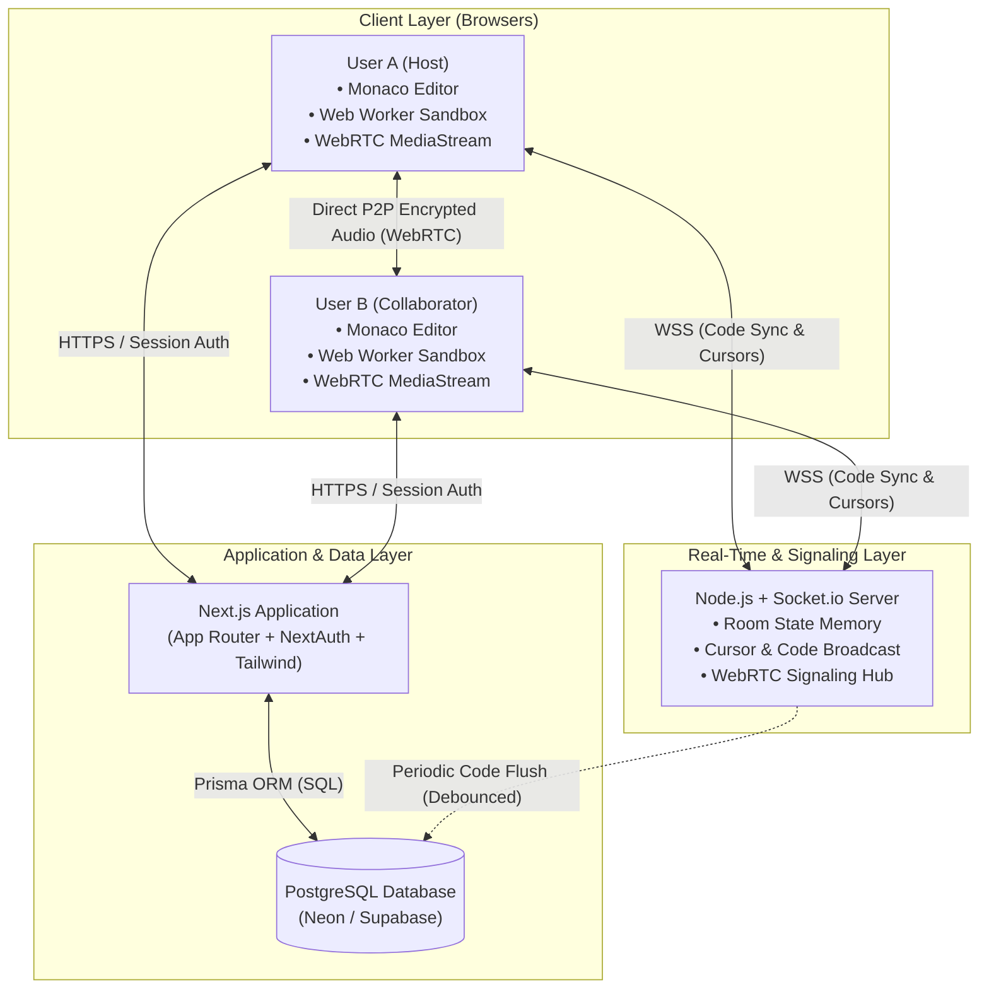
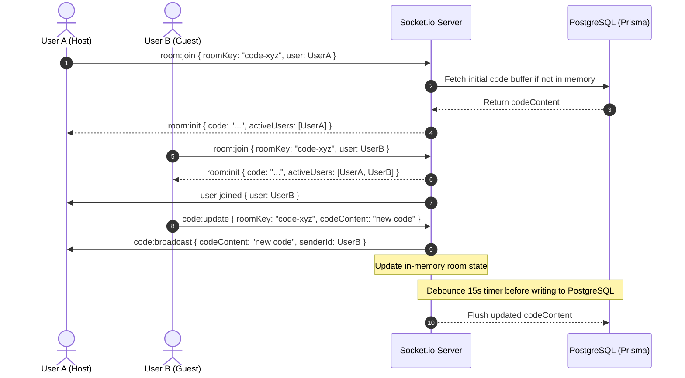
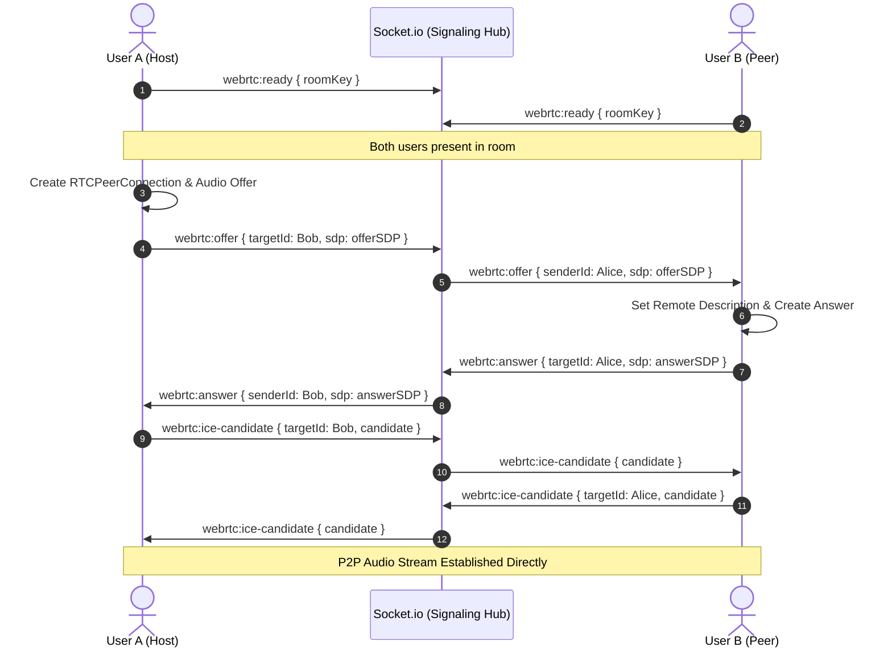
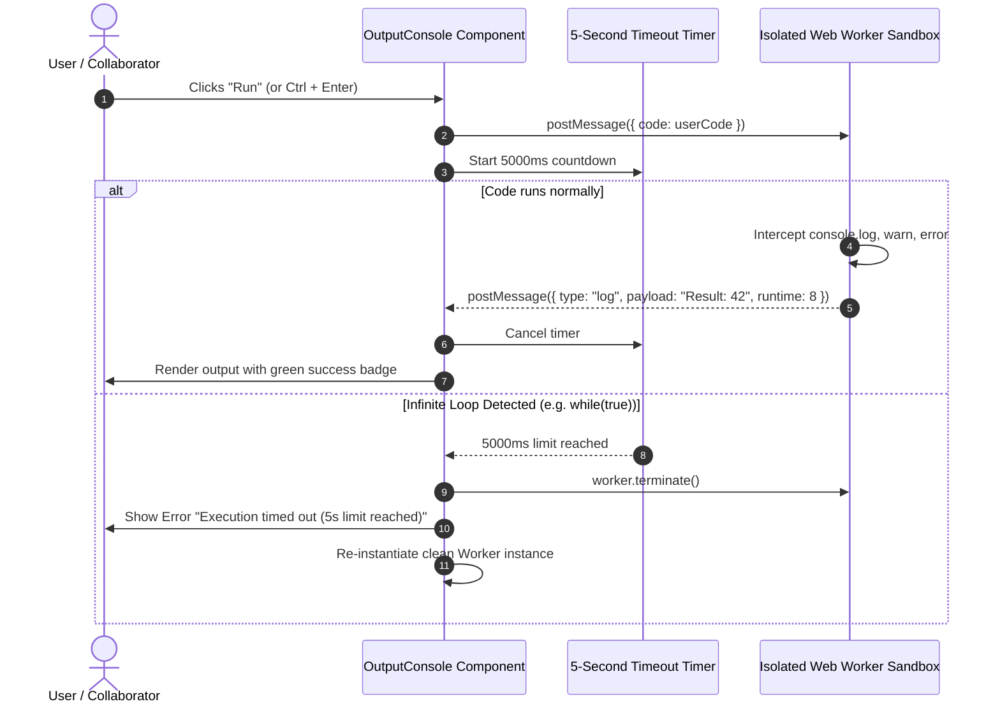
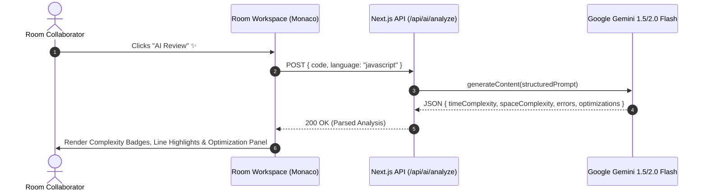
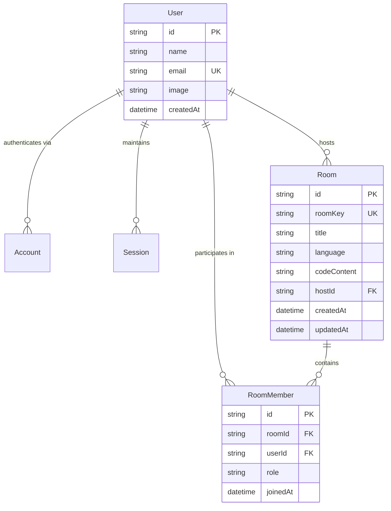
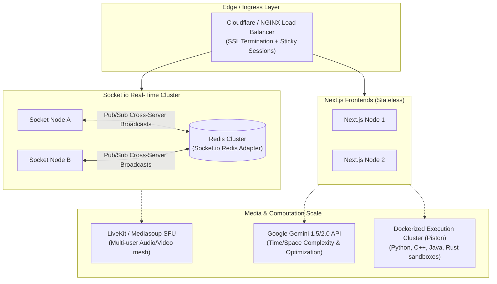

# System Design Document (SDD)

## Project: Real-Time Collaborative Code Editor with Integrated Voice & Sandboxed Execution

**Document Version:** 1.0  
**Status:** Approved / Technical Specification  

---

## 1. High-Level Architecture & System Topology

The system adopts a modern decoupled full-stack architecture:
1. **Next.js Application**: Handles Server-Side Rendering (SSR), UI presentation, NextAuth authentication, and relational data operations via Prisma.
2. **Dedicated Node.js Real-Time Engine**: High-throughput Socket.io service maintaining in-memory room states, cursor broadcasts, and WebRTC audio signaling.
3. **PostgreSQL Database**: Persistent source of truth for users, accounts, sessions, room metadata, and saved code revisions.
4. **Browser Sandbox**: Isolated Web Worker environment for non-blocking, zero-risk JavaScript execution.
5. **Peer-to-Peer WebRTC Mesh**: Direct browser-to-browser encrypted audio streaming for in-room voice calls.

### 1.1 Architecture Diagram



---

## 2. Frontend Architecture (Next.js App Router)

### 2.1 Component Hierarchy
```text
app/
├── layout.tsx                  # Root layout (SessionProvider, ThemeProvider, ToastProvider)
├── page.tsx                    # Landing / marketing page with Dual OAuth modal
├── (auth)/
│   └── signin/page.tsx         # NextAuth custom login page (GitHub & Google buttons)
├── dashboard/
│   └── page.tsx                # User dashboard (Create Room, Join by Key, Past Rooms)
└── room/
    └── [roomKey]/
        └── page.tsx            # Collaborative Room Workspace
            ├── RoomNavbar.tsx          # Key badge, Copy link, Run button, Voice controls
            ├── EditorWorkspace.tsx     # Monaco Editor (SSR disabled) + Remote Cursors
            ├── OutputConsole.tsx       # Bottom/Side drawer for logs, errors, runtime stats
            └── VoiceControls.tsx       # Mic mute/unmute, participant audio badges
```

### 2.2 Client-Side State Management
To keep the application decoupled and performant, client state is managed through modular React hooks:
- `useSocket(roomKey, user)`: Manages WebSocket connection, reconnect backoffs, and emits/receives sync events.
- `useWebRTC(socket, roomKey)`: Manages local audio media stream, peer connections, and audio level detection for active speaker glow.
- `useMonacoSync(editorRef, socket)`: Handles remote cursor decorations and code diff emissions without jumping cursor focus.
- `useCodeRunner()`: Spawns/terminates the isolated Web Worker and collects execution logs.

---

## 3. Real-Time Collaboration & Synchronization Engine

### 3.1 Socket.io Event Protocol

| Event Name | Direction | Payload Structure | Description |
| :--- | :--- | :--- | :--- |
| `room:join` | Client $\to$ Server | `{ roomKey, user: { id, name, image } }` | Client requests entry into room. |
| `room:init` | Server $\to$ Client | `{ code, language, activeUsers: User[] }` | Server sends current document state and participants. |
| `user:joined` | Server $\to$ Room | `{ user: User }` | Notifies peers of a new collaborator. |
| `code:update` | Client $\to$ Server | `{ roomKey, codeContent }` | Emitted when editor content changes. |
| `code:broadcast` | Server $\to$ Room | `{ codeContent, senderId }` | Relays updated code to other peers. |
| `cursor:update` | Client $\to$ Server | `{ roomKey, position: { lineNumber, column } }` | Emitted when local cursor moves. |
| `cursor:broadcast`| Server $\to$ Room | `{ userId, name, color, position }` | Renders collaborator cursor in Monaco. |
| `user:left` | Server $\to$ Room | `{ userId }` | Notifies peers and removes cursor/avatar. |

### 3.2 Sequence Diagram: Room Join & Code Synchronization



### 3.3 Concurrency & Text Collisions
1. **In-Memory Authoritative Cache**: The Socket.io server maintains the current document state in RAM (`rooms.get(roomKey).codeContent`).
2. **Selective Peer Updates**: When broadcasting changes, the server excludes the sender (`socket.to(roomKey).emit('code:broadcast')`), preventing local echo and cursor jump.
3. **Cursor Preservation**: Monaco Editor's `applyEdits` API is used instead of replacing the entire text value on every keystroke, preserving the local user's undo stack and caret position.

---

## 4. WebRTC In-Room Voice Communication Architecture

### 4.1 Signaling Flow via Socket.io
WebRTC establishes direct peer-to-peer audio streams between browsers, requiring only a lightweight signaling mechanism to exchange connection metadata:



### 4.2 Audio Pipeline & Active Speaker Detection
```text
[ Microphone ]
      │
      ▼
[ navigator.mediaDevices.getUserMedia ]
      │
      ├──> [ RTCPeerConnection ] ──> Transmitted to Peer
      │
      ▼
[ AudioContext ] ──> [ AnalyserNode (FFT) ]
                              │
                              ▼
                Audio Frequency / Volume Meter (> Threshold)
                              │
                              ▼
            Active Speaker State: true -> Avatar Glow Indicator
```

---

## 5. Sandboxed Code Execution Engine

### 5.1 Architecture & Isolation
User-submitted JavaScript code is executed entirely in a dedicated browser **Web Worker** spawned via a Blob URL.
- **Security Boundary**: Web Workers cannot touch `window`, `document`, DOM nodes, cookies, or `localStorage`.
- **UI Non-blocking**: Heavy computations or algorithms run on an isolated background thread without freezing Monaco Editor or the UI.

### 5.2 Execution Flow & Watchdog Timeout



---

## 6. AI Code Review, Error Finding & Complexity Engine (Google Gemini)

### 6.1 Architecture & Security Proxy
The AI analysis pipeline integrates **Google Gemini 1.5 / 2.0 Flash** via Google AI Studio. 
- **Security Boundary**: The client never contacts Google AI directly; all requests route through the Next.js API handler (`/api/ai/analyze`), keeping `GEMINI_API_KEY` hidden from the browser.
- **Structured Output**: Gemini is invoked with JSON mode (`responseMimeType: "application/json"`) to ensure strictly typed responses.

### 6.2 AI Analysis Sequence Diagram



### 6.3 Structured Schema Definition

```typescript
export interface AIAnalysisResponse {
  timeComplexity: string;        // e.g. "O(n^2)"
  spaceComplexity: string;       // e.g. "O(1)"
  complexityExplanation: string; // Explains the algorithmic reasoning
  errors: Array<{
    line?: number;
    severity: 'error' | 'warning' | 'info';
    message: string;
  }>;
  optimizationTips: string[];
  optimizedCode: string;
}
```

---

## 7. Data Layer & Prisma Schema

### 6.1 Entity-Relationship Diagram (ERD)



### 6.2 Database Indexing & Optimization Strategy
- **`Room.roomKey`** is indexed with a `UNIQUE` constraint for instant $O(1)$ lookups when users navigate to `/room/[roomKey]`.
- **`RoomMember.userId`** and **`Room.hostId`** are indexed with foreign key indices for fast retrieval of the user's dashboard rooms list.
- **Code Save Debounce**: Keystrokes are not sent to PostgreSQL. Keystrokes only flow through WebSockets. The Socket server debounces database updates (writing at most once every 15 seconds per active room) to minimize write IOPS.

---

## 8. Scaling & Future High-Availability Roadmap

As the platform grows from peer pair-programming to thousands of concurrent rooms, the following scaling paths are designed into the architecture:



### 7.1 Real-Time Server Horizontal Scaling (Redis Adapter)
- When traffic exceeds a single Node.js instance, multiple Socket.io nodes can be deployed behind a load balancer with sticky sessions.
- By integrating `@socket.io/redis-adapter`, rooms and events seamlessly broadcast across different server nodes using Redis Pub/Sub channels (`room:code-xyz`).

### 7.2 WebRTC Scaling: Mesh to SFU (Selective Forwarding Unit)
- For 2 participants: Direct **P2P Mesh** has near-zero infrastructure cost and minimal latency.
- For 3+ participants (Future Team Rooms): Transition to an **SFU** (such as LiveKit or Mediasoup) where each client uploads one upstream audio track, and the SFU distributes downstream tracks to other participants, saving client bandwidth and CPU.

### 7.3 AI Integration Architecture (Google Gemini API)
- A Next.js API Route `/api/ai/analyze` receives the active code snippet.
- Calls Gemini with structured system prompts:
  - System Prompt: *"Analyze the provided JavaScript code for time and space complexity ($O(n)$) and suggest 3 high-impact optimizations."*
  - Output: Structured JSON payload with Big-O complexity tags, explanation, and diff recommendation rendered in an interactive modal.

### 7.4 Multi-Language Code Execution Cluster
- For JavaScript: Client-side Web Worker execution remains default (fastest, $0 server cost).
- For Python, C++, Java: Route execution requests to an isolated container cluster (e.g., [Piston API](https://github.com/engineer-man/piston) or Judge0 in Docker containers) with strict CPU, memory, and network constraints.

---

## 9. Security & Fault Tolerance Measures

1. **Authentication Verification on Socket Handshake**:
   - The Socket.io connection handshake inspects the NextAuth session token cookie. Unauthenticated sockets are rejected before joining any room.
2. **Execution Sandbox Hardening**:
   - Web Worker scripts run in strict mode (`"use strict";`).
   - Web Workers cannot access DOM APIs, cookies, or IndexedDB storage.
3. **Automatic Reconnection & State Recovery**:
   - If a collaborator experiences temporary packet loss or network disconnect, Socket.io automatically attempts reconnection with exponential backoff.
   - Upon reconnecting, the client emits `room:join` and immediately receives the authoritative `room:init` code buffer, resynchronizing any missed characters.
